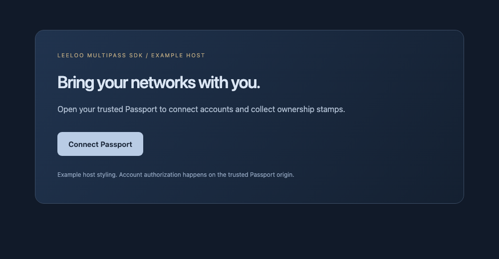

# Leeloo Multipass SDK


A small, dependency-free browser SDK for opening a trusted cross-network Passport. Users manage linked accounts and ownership stamps on their Passport installation; the embedding application receives no social credentials or identity assertions.

The package name `leeloo-multipass-sdk` is provisional, and the package remains `private` to prevent accidental npm publication. The source is original MIT-licensed code. There is no required hosting provider or branded server default.

## Widget preview



This is the real SDK button with example host styling. It opens the operator’s trusted Passport; the SDK does not include the host-page theme or treat a closed window as proof of sign-in.

See the [desktop and mobile Passport screenshots](https://github.com/xirtus/leeloo-multipass#interface) for the destination interface.

## Connect in a few lines

```js
import { createPassportConnect } from './src/index.js';

const passport = createPassportConnect({ origin: 'https://passport.example' });
passport.mountButton(document.querySelector('#passport'), {
  label: 'Connect Passport',
  onError: error => console.error(error.code, error.message),
});
```

The default connection path is `/v1/networks/ui`, matching the current Passport service. Set `connectPath` for another compatible installation. `origin` must be a trusted HTTPS origin, without a path, credentials, query or fragment. Development can explicitly set `allowLoopbackHttp: true` for literal localhost/loopback addresses.

Call `launch()` synchronously from a user click to retain browser popup permission:

```js
button.onclick = () => {
  try {
    const connection = passport.launch({
      provider: 'bluesky', address: 'alice.example.social', presentation: 'popup',
    });
    connection.lifecycle.then(result => {
      // Only the browser window closed. This is NOT proof of account linking.
      console.log(result.verification); // 'unknown'
    }).catch(error => console.error(error.code));
  } catch (error) {
    console.error(error.code); // popup_blocked, invalid_origin, etc.
  }
};
```

`getConnectUrl()` returns a safe, encoded URL for an ordinary link when a popup is unsuitable. It never injects an automatic authorization action. Provider choices prefill the trusted page; the user still chooses what to connect and authorizes it there.

## Current capabilities

`CAPABILITIES` is an immutable catalogue of the current server contract, not a live installation attestation. Operators may deploy a subset. `getCapability(id)` returns an individual entry.

| Capability | Current status | What it means |
| --- | --- | --- |
| Bluesky / AT Protocol | Available | Account ownership through provider OAuth; DID-based identity |
| Mastodon-compatible instances | Available | Profile-read authorization on a compatible instance |
| Matrix | Available | Account proof through supported homeserver browser SSO |
| Threads and ActivityPub | Available | Public profile ownership proof where discovery/bio access works |
| Public profile reference | Available | Save an HTTPS address without claiming ownership |
| Misskey MiAuth | Planned | Native per-instance consent adapter, separate from ActivityPub profile proof |
| IndieAuth | Planned | Website discovery and authorization adapter |
| Nostr | Planned | Scoped public-key challenge using an approved signer; no private-key collection |
| Profile sync | Planned | Independent write permission, preview, conflict handling and revocation |
| Third-party sign-in / IdP | Unavailable | Requires a registered OIDC issuer/relying-party flow |

The launcher accepts `bluesky`, `mastodon`, `matrix`, and `fediverse` provider values. It rejects planned providers instead of silently presenting them as working sign-ins.

## Lifecycle and errors

`launch()` returns `{ url, lifecycle }`. `lifecycle` resolves only as `{ reason: 'closed', verification: 'unknown' }`. Timeout and abort reject with `PassportConnectError`; they stop observation and do not revoke the user's provider session or close a window the user may still be using. A browser's cross-origin isolation policy can sever a window handle, so a close observation cannot establish the result of an authorization flow.

The SDK opens a blank window, clears its `opener`, then navigates to the configured Passport. It does not install a `postMessage` listener, read the new page, fetch account data or receive credentials. `mountButton()` uses `textContent` for caller-provided labels and returns `{ button, destroy() }`.

`signIn()` deliberately rejects with `idp_not_configured`. Account-linking stamps are not authentication assertions for an unrelated application. Do not use a query parameter, popup-close event, screenshot or account handle as proof of login.

## Development

```sh
npm test
npm run check
npm pack --dry-run
```

The tests cover origin/path validation, query injection, unavailable capabilities, opener isolation, popup failure, lifecycle cleanup, cancellation, timeouts, immutable capabilities and text-only button rendering. No test contacts a social account or sends a message.

Read [the architecture](ARCHITECTURE.md), [adapter contracts](docs/ADAPTER_CONTRACTS.md), and [source review](docs/SOURCE_REVIEW.md) before extending the SDK or publishing a release.

## Related projects

[Leeloo Multipass core](https://github.com/xirtus/leeloo-multipass) · [Leeloo Multipass SDK](https://github.com/xirtus/leeloo-multipass-sdk) · [Contribution workflow](CONTRIBUTING.md). New work targets `unstable`.
